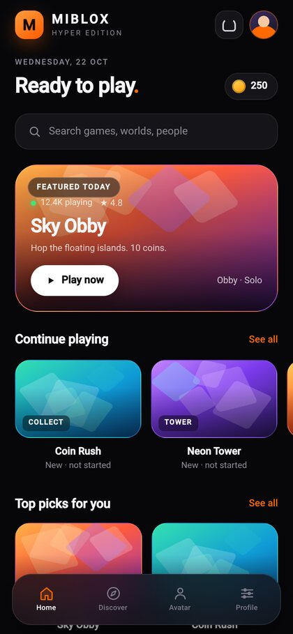
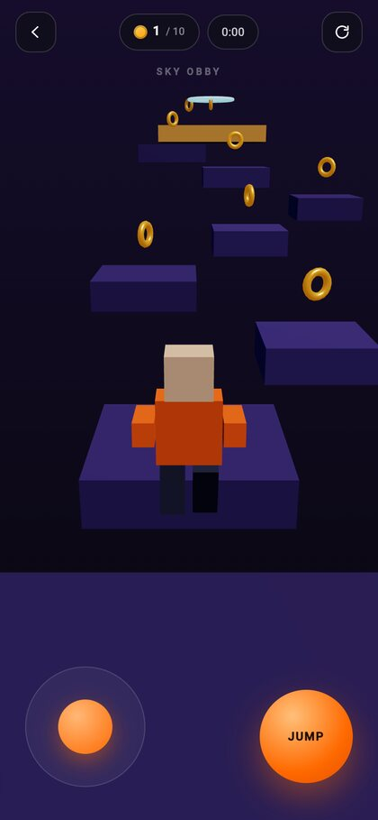
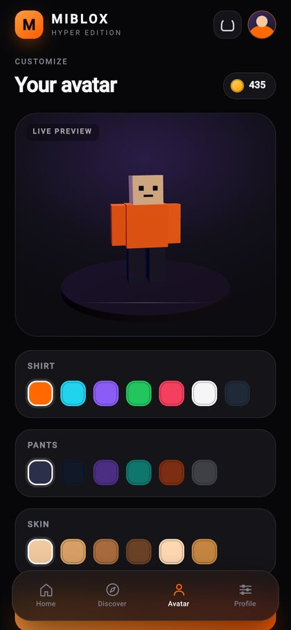
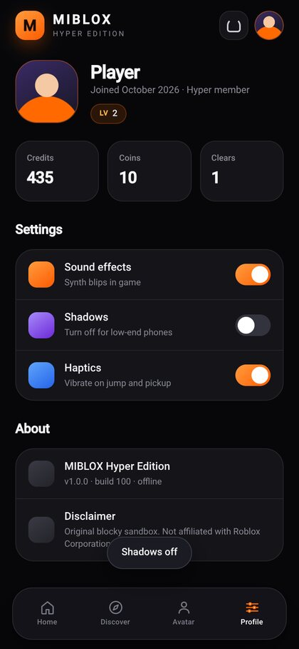

# MIBLOX — Hyper Edition

A **Roblox-style blocky sandbox** with Xiaomi **MIUI / HyperOS** visuals, packaged as an offline Android APK.
Four explorable 3D worlds, a customisable block avatar, coins, credits and progress saved on the device.

> **This is not Roblox.** It is an original app with its own art, code and name.
> It is not affiliated with, endorsed by, or connected to Roblox Corporation, and it does not contain any Roblox code or assets.
> Installing it will not repair or replace the official Roblox app.

[](docs/home.jpg) [](docs/game.jpg) [](docs/avatar.jpg) [](docs/profile.jpg)

## Install on your phone

1. Download **[dist/MIBLOX.apk](dist/MIBLOX.apk)** (open the file on the phone, or `adb install -r dist/MIBLOX.apk`).
2. Tap it and allow "install unknown apps" for the browser/files app you used.
3. MIUI / HyperOS extra step: **Settings → Privacy protection → Special permissions → Install unknown apps →** pick your browser or Files → **Allow**.
4. If you see *"App not installed"*: turn off **MIUI optimization** in Developer options, reboot, retry. Also uninstall any older MIBLOX build first (signatures must match).

Requirements: Android 7.0+ (API 24), WebView with WebGL 2, ~2 MB storage. Fully offline — the app serves its assets from a loopback server inside the APK.

## What's inside

| | |
|---|---|
| **Sky Obby** | Floating islands, 10 coins, easy warm-up |
| **Coin Rush** | Central hub ringed by four islands, 16 coins |
| **Neon Tower** | Spiral climb, 11 coins |
| **Lava Run** | Tight jumps over lava, 8 coins |
| **Avatar studio** | Live 3D preview, shirt / pants / skin colours, saved locally |
| **Profile** | Credits, coins, clears, level, sound / shadow / haptic toggles |

Progression, credits and avatar colours are stored in `localStorage` and survive app restarts.
Clearing a world awards 15 credits per coin plus a time bonus.

**Controls:** left joystick to run, drag anywhere to orbit the camera, `JUMP` to jump. Esc closes a world. On desktop, WASD / arrows + Space.

## Build the APK

No Gradle needed — the build script drives the SDK tools directly.

```bash
export ANDROID_HOME=$HOME/Android/Sdk     # build-tools 35.0.0 + platform android-35
./tools/build.sh                          # -> dist/MIBLOX.apk
```

The APK is signed with a local debug key generated at `~/.android/miblox-debug.keystore` (pass: `android`).
Override with `MIBLOX_KEYSTORE=/path/to/key.jks`. The key is **not** in this repo, so rebuilds signed on another
machine need uninstall/reinstall.

Preview the web layer on a desktop: `./tools/serve.sh` then open <http://127.0.0.1:8099/index.html> at 390×844.

## HeUi — the 2D game engine

`heui/` holds **HeUi**, a 2D game engine with its own Android exporter. MIBLOX is a
Three.js/WebGL app; HeUi is the lean 2D path: a C++ core for the hot loops, a
JavaScript runtime for the game logic, and a Gradle-free APK pipeline.

| | |
|---|---|
| **Gem Hunt** | The sample game: collect gems, avoid hazards, beat the clock. Touch joystick or keyboard, particles, HUD, game-over loop. |
| `heui/native/` | C++ core: math, scene graph, 2D physics, resources, audio, input, and a versioned C ABI. |
| `heui/src/` | JavaScript runtime: engine loop (fixed timestep), input, renderer, audio, resources, native bridge. |
| `heui/converter/` | Bundles a project into one classic script + assets + runtime manifest. |
| `heui/main/` | Android host: activity, WebView, JNI bridge to `libhe.so`, MIUI-aware lifecycle. |
| `heui/build/` | `aapt2 -> javac -> d8 -> zipalign -> apksigner`, NDK build of `libhe.so` for 3 ABIs. |

### Build and install Gem Hunt

```bash
export ANDROID_HOME=$HOME/Android/Sdk     # build-tools 35.0.0 + NDK (optional)
./tools/build-heui.sh                     # -> dist/gem-hunt-debug.apk
adb install -r dist/gem-hunt-debug.apk
```

The APK contains the game in `assets/heui/`, `classes.dex` and `libhe.so` for
`arm64-v8a`, `armeabi-v7a` and `x86_64`. It runs on Android 7.0+ and needs no
network access.

### Work on the engine

```bash
node heui/tools/cli/heui.js doctor              # toolchain check
node heui/tools/cli/heui.js test                # 28 JavaScript tests
(cd heui && npm run test:native)                # 3 native suites (ctest)
node heui/tools/cli/heui.js preview heui/apps/gem-hunt   # headless ASCII preview
```

See [heui/README.md](heui/README.md) and [heui/ARCHITECTURE.md](heui/ARCHITECTURE.md)
for the engine design, and [heui/docs/miui.md](heui/docs/miui.md) for the
MIUI/HyperOS behaviour it is built around.

## Layout

```
android/          manifest, resources, MainActivity (WebView) + loopback asset server
www/              the app: index.html, css/style.css, js/app.js, js/engine.js, js/three.min.js
heui/             the HeUi 2D engine + the Gem Hunt sample game
tools/build.sh    aapt2 -> javac -> d8 -> zipalign -> apksigner   (MIBLOX)
tools/build-heui.sh  same pipeline, driven by the HeUi engine    (Gem Hunt)
tools/serve.sh    desktop preview server
dist/             signed, installable builds
docs/             screenshots
```

## Verification performed

- Headless Chromium (390×844, WebGL via SwiftShader): zero console/page errors.
- All four worlds load, the player spawns grounded, movement, jumping, coin pickup and fall-respawn behave correctly.
- Win flow, credit reward, progress persistence across reload, avatar saving, filters/search and the Android back bridge were exercised end to end.
- APK verified with `apksigner` (v2 + v3 signatures); manifest, permissions, launcher activity and bundled assets inspected.
- HeUi: 28/28 JavaScript tests and 3/3 native suites pass; the bundled game boots and plays in a headless browser; the APK is signed (v2 + v3) and contains `classes.dex`, the game assets and `libhe.so` for three ABIs.
- **Not** verified on a physical phone or emulator — none was available in the build environment. The WebView shell
  is deliberately plain (one activity, no AndroidX) to keep the risk low.
